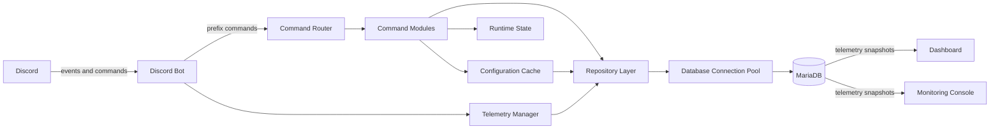

# 🔧 Code Examples & Architecture

This document gives a public overview of the MCLP Discord Bot's architecture and selected programming patterns.

> **Note:** The full bot source code is private. The examples include simplified extracts and illustrative pseudocode;
> they may omit imports, dependencies, and application-specific details and are not intended as standalone implementations.
> The architecture and persistence notes describe the current service; consult the [Terms of Service](./Legal/TERMS_OF_SERVICE.md)
> and [Privacy Policy](./Legal/PRIVACY_POLICY.md) for user-facing feature and data-handling details.

---

## 📁 Architecture Overview

### Project Structure

```
Discord-Bot/
├── src/
│   ├── main.py                                  # Entry point
│   ├── bot.py                                   # Bot lifecycle and Discord events
│   └── internal/
│       ├── command_router.py                    # Prefix-command routing
│       ├── rate_limiter.py                      # Limits, cooldowns, and flood protection
│       ├── status_cycle.py                      # Status rotation
│       ├── utils.py                             # Configuration, authorization, and helpers
│       ├── database/
│       │   ├── config.py                        # Database connection settings
│       │   ├── config_cache.py                  # Global and guild configuration cache
│       │   ├── pool.py                          # Connection pool and transactions
│       │   └── repositories/
│       │       ├── config_repository.py         # transactional storage for global and per-guild configuration
│       │       ├── moderation_repository.py     # Transactional storage for moderation data
│       │       ├── poll_repository.py           # Transactional storage for active polls
│       │       ├── reaction_role_repository.py  # Transactional storage for emoji-to-role mappings
│       │       ├── reminder_repository.py       # Transactional storage for active one-shot and scheduled reminders
│       │       └── telemetry_repository.py      # Transactional storage for bot-instance telemetry
│       ├── command_modules/
│       │   ├── calculator.py                    # High capability calculator
│       │   ├── dedicated_server_chat.py         # Message bridge to send MC message to DC and vice versa
│       │   ├── dedicated_server_commands.py     # !server-start, !server-restart, !server-stop, ...
│       │   ├── game_commands.py                 # !portal, !stronghold, !potion, ...
│       │   ├── game_commands_core.py            # Advanced logic and calculation for game commands
│       │   ├── logging_setup.py                 # Custom logging handler and file rotation setup
│       │   ├── minigames.py                     # Games: !Quiz, !Hangman, !RPS, ...
│       │   ├── moderation_commands.py           # !kick, !ban, !timeout, !untimeout, ...
│       │   ├── public_commands.py               # !help, !info, !serverinfo, ...
│       │   ├── scientific_commands.py           # !apod, !sun, !asteroids, ...
│       │   ├── system_commands.py               # Bot-Maintainer & Server-Admin controls
│       │   ├── utility_commands.py              # !weather, time, reminders, polls, ...
│       │   └── music/
│       │       ├── music_commands.py            # !play, !pause, !resume, !skip, ...
│       │       └── player.py                    # Music player logic
│       └── data/
│           ├── game_commands_data.json          # Ore Dictionary, potion recipes, ...
│           ├── hangman.json                     # Hangman word lists
│           └── quiz.json                        # Quiz questions
├── monitoring/
│   ├── collectors/                              # Runtime event and metric collectors
│   ├── console/                                 # Monitoring console
│   ├── dashboard/                               # Web dashboard
│   ├── models/                                  # Monitoring data models
│   └── telemetry_manager.py                     # Central telemetry handler
└── tools/
    ├── broadcast_system/                        # Optional announcement utility
    └── preflight_database.py                    # Database readiness checks
```

This is a selected overview of the private implementation, not a complete file
inventory. The database layer is included to show how operational state is
stored; credentials and connection values are not part of this public tree.
The JSON files shown above contain static game data, not operational state.

### Component Relationships

The diagram shows the main runtime and storage relationships at a high level.

<!-- mermaid-checked: no \n, no em-dash/en-dash, no {} in labels, unique ids -->


The bot initializes the configuration cache at startup, and command modules use
it at runtime. Runtime state is held in memory, while selected operational data
and telemetry are persisted in MariaDB. The dashboard and console read telemetry
from the database, rather than directly from the telemetry manager.

---

## 🎯 Design Patterns

### 1. Command Router Pattern

The bot uses a centralized command routing system with grouped command handlers:

```python
# Simplified example of the command routing approach

# Command groups definition
command_groups = {
    'utility': ['!ping', '!uptime', '!weather', '!city',  ...],
    'minigames': ['!rps', '!hangman', '!quiz', '!guess', '!roll'],
    'public': ['!help', '!info', '!rules', '!userinfo', ...],
    'moderation': ['!kick', '!ban', '!unban', '!timeout', ...],
    'scientific': ['!apod', '!marsphoto', '!asteroids', ...],
    'game': ['!portal', '!ore', '!potion', '!stronghold', ...],
    'music': ['!join', '!leave', '!play', '!pause', ...],
}

# Command handlers mapping
command_handlers = {
    'utility': handle_utility_commands,
    'minigames': handle_minigames_commands,
    'public': handle_public_commands,
    'moderation': handle_moderation_commands,
    'scientific': handle_scientific_commands,
    'game': handle_game_commands,
    'music': handle_music_commands,
}

# Commands that cannot be executed in DMs
no_dm_commands = ['!kick', '!ban', '!unban', '!timeout', '!play', '!join', ...]


async def handle_command(client, message):
    # Route incoming commands to the appropriate handler.
    user_message = message.content.strip()
    command_token = user_message.split(maxsplit=1)[0].lower()

    # Per-user spam protection
    if command_token.startswith('!'):
        spam_allowed, spam_msg = await check_user_spam(message.author.id)
        if not spam_allowed:
            await message.channel.send(spam_msg)
            return None

    # Block commands that require a server context
    if message.guild is None and command_token in no_dm_commands:
        await message.channel.send("⚠️ This command cannot be executed in a DM environment.")
        return None

    # Route to the matching command group handler
    for group, commands in command_groups.items():
        if command_token in commands:
            return await command_handlers[group](client, message, user_message)

    # Unknown command feedback
    if command_token.startswith('!'):
        await message.channel.send("❓ Unknown command. Type !help for a list of available commands.")
    return None
```

**How routing fits into the current bot:**
- Prefix messages pass through checks in `src/bot.py` before `command_router` routes them to a command module.
- Routing includes message-length checks, a per-user spam limit, and restrictions on commands that cannot run in DMs.
- `!calc` has a dedicated handler; other prefix commands are routed by command group.
- Slash interactions use a central interaction check for security and rate-limit controls.

The snippet is a simplified illustration; it does not show the full ordering of production checks or slash-command handling.

---

### 2. Rate Limiting System

Rate limits and cooldowns help protect commands and external APIs from excessive use:

```python
# Simplified representation of the rate-limiting architecture

class RateLimitPolicy:
    def __init__(self, max_requests: int, window_seconds: int):
        self.max_requests = max_requests
        self.window_seconds = window_seconds


class RateLimitManager:
    def __init__(self):
        self.policies = {}
        self.request_history = {}

    def register_policy(self, name: str, policy: RateLimitPolicy):
        self.policies[name] = policy

    def check_request(self, policy_name: str, identifier: str) -> bool:
        policy = self.policies.get(policy_name)

        if policy is None:
            return False

        # Apply the corresponding request-window policy.
        # Expired entries are cleaned up automatically.
        # The production implementation includes additional safeguards.
        return self._evaluate_request(policy, identifier)

    def _evaluate_request(self, policy, identifier) -> bool:
        # Illustrative policy evaluation.
        ...


# Independent protection policies
rate_limits = RateLimitManager()

rate_limits.register_policy(
    "user_commands",
    RateLimitPolicy(max_requests=..., window_seconds=...)
)

rate_limits.register_policy(
    "external_api",
    RateLimitPolicy(max_requests=..., window_seconds=...)
)
```

**Features:**
- Independent rate-limit policies for different request categories
- Per-user command protection
- Configurable external API request limits
- Global emergency cooldown functionality
- Runtime tracking separated from persistent configuration

The production implementation contains additional validation, cleanup, and exception-handling mechanisms.

---

### 3. Permission System

Authorization combines global and guild-level access controls with Discord permissions where required:

```python
# Illustrative authorization flow; names and signatures are not production APIs.
async def may_run_admin_action(interaction) -> bool:
    # Must be used in a guild
    if interaction.guild is None:
        await interaction.response.send_message("❌ **This command can only be used in a server.**", ephemeral=True)
        return False

    # Emergency and blacklist helpers handle rejected interactions.
    if await check_emergency_measures(interaction):
        return False
    if await check_blacklist(interaction):
        return False

    if not is_authorized_server(interaction.user, guild_id=interaction.guild.id):
        await interaction.response.send_message("❌ **Permission denied.**", ephemeral=True)
        return False
    return True
```

Global and guild allowlists, global blocklists, and guild-level access settings
are stored in MariaDB. The guild owner is trusted for guild-level authorization;
some moderation actions also require the corresponding Discord permission.
Public commands are available subject to the bot's security and abuse-prevention
checks. Exact access requirements depend on the command.

---

### 4. Configuration and Persistence

MariaDB is the source of truth for operational configuration and persistent bot
features. The application uses a database-backed configuration cache and
repositories; there is no JSON fallback for operational state.

```python
from internal import utils

async def update_bot_status(guild_id: int) -> None:
    if not utils.is_config_ready():
        raise RuntimeError("Database configuration is not initialized")

    # Ensure a guild row exists, then read a snapshot from the cache.
    await utils.ensure_guild_config(guild_id)
    guild_settings = utils.load_server_config(guild_id)
    print("Guild command logging:", guild_settings.get("LoggingActivated"))

    # The cache is updated immediately; persistence runs in the background.
    utils.set_config_value("BotStatus", {"type": "playing", "text": "with MCLP"})
```

This illustrative example uses configuration helper names from the bot. It
assumes database initialization has completed and runs inside an event loop.
Guild rows are normally ensured during startup and when a guild joins.

Reads use in-memory snapshots. Configuration updates change the cache first and
schedule persistence to MariaDB; returning from `set_config_value` does not
confirm that the database write has completed. Persistence errors are logged
and idempotent configuration writes are retried. `load_config()` returns an
empty dictionary before the cache is initialized, while writes and guild
configuration access raise an error. There is no local JSON fallback for
operational configuration.

**Persistence boundaries:**
- **MariaDB:** Global and guild configuration, access lists, warnings and audit
  events, reaction-role mappings, active reminders, polls and votes, and telemetry.
- **Read-only JSON:** Static game content such as quiz and hangman data.
- **Runtime memory:** Music queues, active game state, temporary limiter windows,
  and flood-protection counters.
- **Environment:** Runtime credentials and API keys.

Active reminders, polls, and emergency settings are restored after a restart.

---

## 🎵 Music System Architecture

### Player Design

The music system uses a per-guild state dictionary with platform-aware configuration:

```python
# Simplified music player example

music_state = {}

def get_guild_state(guild_id: int) -> dict:
    # Get or create per-guild music state.
    if guild_id not in music_state:
        music_state[guild_id] = {
            "queue": [],
            "current": None,
            "last": None,           # previous track used by !last
            "voice_client": None,
            "playing": False,
            "repeat_mode": "off",
            "error_count": 0,
            "last_error_time": None,
        }
    return music_state[guild_id]
```

### Source Detection & yt-dlp Configuration

```python
# Source-specific yt-dlp options
YTDLP_OPTIONS_YT = {
    **_YTDLP_BASE,
    "format": "251/250/249/140/opus/m4a/aac/best...",
    "default_search": "ytsearch",
    "extractor_args": {"youtube": {"player_client": ["android", "web"]}},
}

YTDLP_OPTIONS_SC = {
    **_YTDLP_BASE,
    "format": "hls_mp3/hls_opus/hls_aac/best",
}

# Source-specific ffmpeg options
FFMPEG_OPTIONS_YT = {
    "before_options": "-reconnect 1 -reconnect_streamed 1 -reconnect_delay_max 10",
    "options": "-vn",
}

FFMPEG_OPTIONS_SC = {
    "before_options": "-rw_timeout 20000000",  # No -reconnect (crashes with HLS/redirects)
    "options": "-vn",
}

def _is_soundcloud(query: str) -> bool:
    q = query.lower()
    return "soundcloud.com" in q or q.startswith("scsearch:")

def get_ytdlp_options(query: str) -> dict:
    # Return appropriate yt-dlp options based on query source.
    if _is_soundcloud(query):
        return YTDLP_OPTIONS_SC
    return YTDLP_OPTIONS_YT
```

### FFmpeg Resolution

```python
def resolve_ffmpeg_executable() -> str:
    # Resolve FFmpeg for the host environment.
    # The production service requires FFmpeg for voice playback.
    ...
```

### Playback & Queue Logic

```python
async def add_to_queue(guild: discord.Guild, query: str):
    # Add a song to the queue with queue size limits.
    state = get_guild_state(guild.id)

    # Run yt-dlp extraction in executor so playback loop stays responsive.
    loop = asyncio.get_event_loop()
    song = await loop.run_in_executor(None, extract_audio, query)
    state["queue"].append(song)

    if not state["playing"]:
        await play_next(guild)
    return song


async def play_next(guild: discord.Guild):
    # Play next song with repeat mode support and error recovery.
    state = get_guild_state(guild.id)
    repeat_mode = state.get("repeat_mode", "off")
    current = state.get("current")

    # Handle repeat modes (one / all / off)
    if repeat_mode == "one" and current:
        song = current
    elif repeat_mode == "all" and current and not state["queue"]:
        song = current
    else:
        if not state["queue"]:
            if current:
                state["last"] = current
            state["playing"] = False
            state["current"] = None
            return
        song = state["queue"].pop(0)

    if current and song is not current:
        state["last"] = current

    source = discord.FFmpegPCMAudio(song["url"], **get_ffmpeg_options(song.get("source")))

    def after_play(error):
        if error:
            ...
        else:
            state["error_count"] = 0
        loop.call_soon_threadsafe(lambda: asyncio.create_task(play_next(guild)))

    voice_client.play(source, after=after_play)
```

### Previous Track (!last)

```python
# !last support: preserve previous song and allow rewinding playback.
async def replay_last(message):
    state = player.get_guild_state(message.guild.id)
    last_song = state.get("last")
    current = state.get("current")
    queue = state.get("queue", [])

    if not last_song:
        await message.channel.send("ℹ️ **No previous track available.**")
        return

    # Put current back first, then play previous track next.
    if current is not None:
        queue.insert(0, current)
    queue.insert(0, last_song)

    vc = state.get("voice_client")
    if vc and (vc.is_playing() or vc.is_paused()):
        vc.stop()  # after-callback starts queue[0]
```

### Graceful Shutdown

```python
async def disconnect(guild_id: int):
    # Graceful disconnect: stop playback, wait for FFmpeg, then disconnect.
    state = get_guild_state(guild_id)
    vc = state.get("voice_client")
    current = state.get("current")
    if current:
        state["last"] = current
    if vc:
        if vc.is_playing() or vc.is_paused():
            vc.stop()
            await asyncio.sleep(0.5)  # Wait for FFmpeg to terminate
        await vc.disconnect(force=True)
        # Cleanup state
        ...


async def cleanup_all_guilds(bot):
    # Clean up all voice connections before bot shutdown.
    for guild in bot.guilds:
        if guild.voice_client:
            await disconnect(guild.id)
    music_state.clear()
```

### Music Channel Enforcement

```python
# URL domain whitelist
ALLOWED_MUSIC_DOMAINS = {"youtube.com", "www.youtube.com", "youtu.be",
                          "soundcloud.com", "www.soundcloud.com"}

async def is_music_channel(message) -> bool:
    # Ensure commands are used in the designated music channel.
    cfg = load_server_config(message.guild.id)
    music_channel_id = cfg.get("music_channel_id")
    if music_channel_id is None:
        await message.channel.send("❌ Music channel not set. Use !music-channel.")
        return False
    if message.channel.id != int(music_channel_id):
        await message.channel.send(f"❌ Please use <#{music_channel_id}>.")
        return False
    return True
```

### Interactive Queue Display

```python
class QueueView(ui.View):
    # Paginated queue display with interactive buttons.
    def __init__(self, guild_id: int, current_page: int = 0, owner_id: int | None = None):
        super().__init__(timeout=180)
        ...

    async def interaction_check(self, interaction) -> bool:
        # Only the command user can change pages.
        ...

    @ui.button(label="⬅️ Previous", style=discord.ButtonStyle.blurple)
    async def previous_page(self, interaction, button): ...

    @ui.button(label="➡️ Next", style=discord.ButtonStyle.blurple)
    async def next_page(self, interaction, button): ...

    async def on_timeout(self):
        # Disable buttons after 3 minutes.
        ...
```

**Features:**
- YouTube & SoundCloud support with source-specific configurations
- Per-guild queue and playback state held in memory
- Three repeat modes: off, one, all
- FFmpeg-based voice playback
- Paginated queue display with interactive Discord UI buttons
- Music channel configuration is stored with guild settings; accepted URLs are limited to YouTube and SoundCloud
- Graceful shutdown with FFmpeg cleanup across all guilds

The playback queue and `!last` state are runtime-only and normally disappear
when the bot process stops. The music-channel setting is persistent.

---

## 🛡️ Security Practices

### 1. Calculator Input Validation

An illustration of input-validation layers used before expression evaluation:

```python
# Simplified sketch; pattern checks and bracket checks are omitted.
def is_safe_expression(expression: str) -> tuple[bool, str]:
    if not expression:
        return False, "Expression cannot be empty"
    if len(expression) > MAX_EXPRESSION_LENGTH:
        return False, "Expression is too long"
    if "\x00" in expression:
        return False, "Expression contains null bytes"

    # And similar checks
    ...

    # Check forbidden patterns and suspicious escape sequences.
    ...

    for check in (
        check_expression_complexity,
        validate_function_calls,
        validate_variable_names,
    ):
        is_valid, error_message = check(expression)
        if not is_valid:
            return False, error_message

    # Check brackets before accepting the expression.
    if expression.count...
    ...
    return True, ""
```

**Security layers illustrated above:**
- Reject empty or oversized expressions and null bytes.
- Detect forbidden patterns and suspicious escape sequences.
- Limit expression complexity, including nesting depth and operation count.
- Allow only approved functions and variable names.
- Check bracket structure before evaluation.

Ordinary calculator expressions use a separate process with a timeout, as
described under **Timeout Protection** below. This does not cover every
calculation path.

This sketch shows the validation order and `(valid, error message)` return
shape. It omits pattern and bracket checks and is not an executable security
validator or a complete description of production safeguards.
Pattern matching alone does not make evaluating untrusted expressions safe.

---

### 2. Safe Access to Static Files

The bot reads fixed game-data files through dedicated helpers. This simplified
example shows how a caller can check the result before using quiz data:

```python
from internal import utils

def initialize_quiz() -> dict:
    quiz_data = utils.load_quiz()
    if not quiz_data:
        raise RuntimeError("Quiz data is missing, invalid, or empty")
    return quiz_data

# The quiz data is then loaded with the utils.py module using an atomic read system.
def load_quiz() -> dict:
    return _atomic_read(_abs_path("quiz.json")) or {}
```

The real helpers load the fixed quiz, hangman, and game-utility JSON files
from the data directory. They return an empty dictionary when content cannot
be loaded; malformed JSON and other read errors are logged. The caller-side
exception above illustrates one way to handle an empty result and is not the
bot's production initialization code.

A separate relative-path JSON loader rejects absolute paths, `..` and
non-JSON filenames. These files are read-only game content; operational
configuration and persistent feature data are stored in MariaDB.

---

### 3. Database Access with a Repository

Persistent feature data is managed by dedicated repositories. This simplified
example illustrates how the reminder repository deletes a user's reminder:

```python
class ReminderRepository:
    def __init__(self, database: DatabasePool) -> None:
        self._database = database

    async def delete(self, reminder_id: str, user_id: int) -> bool:
        async with self._database.transaction() as connection:
            async with connection.cursor() as cursor:
                await cursor.execute(
                    "DELETE FROM reminders WHERE reminder_id = %s AND user_id = %s",
                    (reminder_id, user_id),
                )
                return cursor.rowcount == 1
```

- The repository encapsulates the database operation; its connection pool is
  supplied by the application, not configured with credentials in the code.
- The parameterized query passes values separately from the SQL statement, and
  matches both the reminder ID and its creator's user ID.
- The transaction commits on success and rolls back on errors. Database errors
  propagate to the caller rather than being reported as a successful deletion.
- The result is `True` if one matching row was deleted, or `False` if none was
  deleted. The caller is responsible for handling the result and any errors.

This is an illustrative extract, not a complete repository or a replacement for
the bot's command-level permission checks and reminder lifecycle.

---

### 4. Timeout Protection

Ordinary calculator expressions run in a separate process, allowing work that
exceeds its timeout to be terminated. This does not apply to every calculator
path. The following illustrates the control flow without reproducing the
process-management implementation:

```python
# Pseudocode: process lifecycle and result handling are omitted.
async def calculate_with_timeout(expression: str) -> str:
    process = start_calculation_process(expression)
    await wait_for_process(process, CALCULATION_TIMEOUT)
    if process.is_alive():
        terminate_process(process)
        raise CalculatorError("Calculation timed out")
    return read_calculation_result(process)
```

**Protection:**
- Ordinary calculator expressions run in a separate process that can be terminated on timeout
- The wait is performed without blocking the event loop
- A timeout limits calculation duration; it does not eliminate all resource-exhaustion risks
- Also used for minigame input timeouts (`asyncio.wait_for`)
---

## 📊 Logging System

The bot writes operational logs for startup/shutdown, errors, warnings,
permission denials, command failures, and security or flood-protection events.
Operational logging cannot be disabled. Guild command logging is separately
controlled by guild settings and channel rules; it records Discord IDs and the
command token, not command arguments.

```python
# Illustrative example: use structured fields and never log credentials.
logging.warning(
    "Command rejected: permission check failed (user_id=%s, guild_id=%s)",
    user_id,
    guild_id,
)

logging.error(
        "Command execution failed: command=%s error_type=%s",
        command,
        error_type
    )

# A custom configured file handler is used for log writing and rollover / deletion of logs
class CustomTimedRotatingFileHandler(logging.FileHandler):
    ...
```
- Centralized operational logging
- Structured event information
- Separate handling of command failures and security events
- Permission-denial and abuse-prevention event tracking
- Configurable log-file management

Sensitive credentials are excluded from log output
Log files are written to the configured directory. The application attempts to
remove files older than 14 days based on modification time and does not remove
the active file.

---

## 🚨 Emergency System

Two emergency measures controlled via slash commands, with state persistence across restarts:

```python
# Simplified emergency system example

# Illustrative in-memory view of state that is persisted in MariaDB.
emergency_lockdown_mode = False
emergency_lockdown_owner_id = None
emergency_lockdown_time = None


class GlobalCooldown:
    # Global emergency cooldown for all commands
    def __init__(self):
        self.is_active = False
        self.cooldown_seconds = 0
        self.last_command_time = {}  # user_id -> timestamp

    def activate(self, cooldown_seconds: int = 60, reason: str = "..."): ...
    def deactivate(self): ...
    def check_allowed(self, user_id: int) -> Tuple[bool, float]: ...
    def get_status(self) -> str: ...

global_cooldown = GlobalCooldown()


# Slash commands (available to globally authorized operators)
# /emergency-lockdown  — Blocks guild messages and application-command interactions;
#                         globally authorized users can use commands through DMs
# /emergency-cooldown  — Activates a 1-300 second global command cooldown
# /emergency-reset     — Deactivates emergency measures and restores normal status


# Illustrative persistence call; the exact repository API is private.
async def save_emergency_state(user_id: int):
    await persist_emergency_settings(
        lockdown=True,
        lockdown_owner_id=user_id,
        cooldown=True,
        cooldown_seconds=60,
    )

# Bot status reflects emergency state
# Lockdown:  🚨 Emergency Lockdown Active  (DND)
# Cooldown:  ⏸️ Global Cooldown: 60s        (Idle)
# Reset:     Restores original status from BotStatus config


# Simplified illustration of the central message/interaction security gate.
if emergency_lockdown_mode:
    if guild_context:
        reject_request()
    if not is_authorized_global(user):
        reject_request()

if global_cooldown.is_active and not is_maintenance_command(command):
    allowed, remaining = global_cooldown.check_allowed(user.id)
    if not allowed:
        reject_with_cooldown(remaining)
```

**Features:**
- **Lockdown** — restricts bot to whitelisted users only, blocks all guild messages
- **Cooldown** — enforces per-user delay on all commands
- Active state is persisted in MariaDB and restored after a bot restart
- Automatic state restoration on startup
- Bot presence reflects active emergency measures
- `/emergency-reset` deactivates both and restores original status

---

## 🔄 Status Rotation

Config-driven status cycling with safety limits, uptime placeholders, and message parsing:

```python
# Simplified status-cycle example; configuration is database-backed.

# Safety constants
MIN_STATUS_DURATION_MINUTES = 2.5
MIN_CYCLE_INTERVAL_MINUTES = 30
MAX_STATUSES_PER_CYCLE = 10

_last_activity_signature: tuple[str, str] | None = None


class StatusCycleBot(commands.Bot):
    # Extends commands.Bot with status cycle management
    def __init__(self, *args, **kwargs):
        super().__init__(*args, **kwargs)
        self.status_cycle_task: asyncio.Task | None = None
        self.status_cycle_stop_event: asyncio.Event | None = None

    async def start_status_cycle(self) -> bool: ...
    async def stop_status_cycle(self) -> bool: ...


def _build_activity(status_type: str, status_text: str) -> discord.Activity | None:
    # Map config strings to Discord activity types
    mapping = {
        "playing": discord.ActivityType.playing,
        "listening": discord.ActivityType.listening,
        "watching": discord.ActivityType.watching,
        "competing": discord.ActivityType.competing
    }
    activity_type = mapping.get(status_type.lower().strip())
    if not activity_type:
        return None
    return discord.Activity(type=activity_type, name=status_text)


async def _apply_status(bot: commands.Bot, status_data: dict) -> None:
    # Apply a status, replacing placeholders like {uptime}
    status_text = status_data.get("text", "")
    status_text = status_text.replace("{uptime}", _format_uptime())

    activity = _build_activity(status_data.get("type", ""), status_text)
    if activity is None:
        return

    # Skip if status hasn't changed (avoid unnecessary API calls)
    signature = (activity.type.name, activity.name or "")
    if _last_activity_signature == signature:
        return

    await bot.change_presence(activity=activity)


async def _run_status_cycle(bot: commands.Bot, stop_event: asyncio.Event) -> None:
    # Main cycle loop
    while not stop_event.is_set():
        cfg = utils.get_config_value("StatusCycle", default={}) or {}
        statuses = cfg.get("statuses", []) or []
        every_minutes = cfg.get("every_minutes", 120)

        # Enforce safety limits
        if every_minutes < MIN_CYCLE_INTERVAL_MINUTES:
            every_minutes = MIN_CYCLE_INTERVAL_MINUTES
        if len(statuses) > MAX_STATUSES_PER_CYCLE:
            statuses = statuses[:MAX_STATUSES_PER_CYCLE]

        # Cycle through statuses
        for status in statuses:
            ...

        # Restore default status between cycles
        default_status = utils.get_config_value("BotStatus", default=None)
        if isinstance(default_status, dict):
            await _apply_status(bot, default_status)

        # Wait for next cycle
        try:
            await asyncio.wait_for(stop_event.wait(), timeout=every_minutes * 60)
        except asyncio.TimeoutError:
            pass
```

### Slash Command: `/status_cycle`

The following example outlines the command flow; validation and message
parsing are omitted for brevity.

```python
# Simplified /status_cycle command
def setup_status_cycle_commands(bot: StatusCycleBot) -> None:
    @bot.tree.command(name="status_cycle", description="Start/stop/configure status cycling")
    @utils.emergency_lockdown_check()
    async def status_cycle(
        interaction: discord.Interaction,
        action: str,
        every_minutes: Optional[float] = None,
        statuses_json: Optional[str] = None,
        message_id: Optional[str] = None,
        status_type: Optional[str] = None,
    ):
        if not utils.is_authorized_global(interaction.user):
            await interaction.response.send_message("❌ Permission denied.", ephemeral=True)
            return

        action = action.strip().lower()
        cfg = utils.get_config_value("StatusCycle", default={}) or {}

        if action == "status":
            enabled = bool(cfg.get("enabled", False))
            interval = cfg.get("every_minutes", 120)
            count = len(cfg.get("statuses", []) or [])
            await interaction.response.send_message(
                f"Status cycle: {'ON' if enabled else 'OFF'} | "
                f"Interval: {interval} min | Entries: {count}",
                ephemeral=True,
            )
            return

        if action == "start":
            cfg["enabled"] = True
            utils.set_config_value("StatusCycle", cfg)
            started = await bot.start_status_cycle()
            ...

        if action == "stop":
            cfg["enabled"] = False
            utils.set_config_value("StatusCycle", cfg)
            stopped = await bot.stop_status_cycle()
            ...

        if action == "set":
            # Validate the interval and JSON status entries, then save the configuration.
            ...
            return

        if action == "from_message":
            # Fetch the message, parse its status lines, then save the configuration.
            ...
            return

        await interaction.response.send_message(
            "❌ Invalid action. Use start, stop, status, set, or from_message.",
            ephemeral=True,
        )
```

The command is limited to globally authorized users. `set` accepts an interval
and/or a JSON list of status entries; `from_message` reads status lines from a
message in the current text channel or thread. Both validate their inputs
before updating the MariaDB-backed configuration. For example:

```text
[playing] "Exploring the cosmos" 5
[listening] "to {uptime}" 2.5
[watching] "over {servers} servers" 10
```

Each line supplies an optional activity type, status text, and duration in
minutes. Empty lines and lines beginning with `#` are ignored.

**Features:**
- Configurable cycle with per-status durations and activity types
- Safety limits: min 2.5min per status, min 30min cycle interval, max 10 entries
- Placeholder support (`{uptime}`, `{uptime_duration}`)
- Cycle settings are stored in MariaDB configuration
- `from_message` — parse statuses directly from a Discord message
- Graceful stop via `asyncio.Event` (no task cancellation)
- Restores default `BotStatus` between cycles and on stop
- Duplicate detection — skips API call if status unchanged
---

## 📚 API Integration Patterns

All external API calls follow the same pattern: rate limit check → request with timeout → error handling.

```python
# Simplified API integration example

# API keys loaded from environment variables (never hardcoded)
NASA_API_KEY = os.getenv('NASA_API_KEY')
OPENWEATHERMAP_API_KEY = os.getenv('OPENWEATHERMAP_API_KEY')

# Rate-limit settings are configurable and stored in MariaDB.
api_limiter_nasa = RateLimiter(max_requests=5, time_window=60)
api_limiter_openweather = RateLimiter(max_requests=10, time_window=60)


async def api_request(session, url: str, params: dict, timeout: int = 10) -> dict:
    # Illustrative request helper: callers handle explicit failures.
    async with session.get(
        url,
        params={key: value for key, value in params.items() if value is not None},
        timeout=aiohttp.ClientTimeout(total=timeout),
    ) as response:
        response.raise_for_status()
        return await response.json()


# Usage in commands:

async def send_apod(session, message):
    # 1. Check rate limit
    allowed, error_msg = await check_api_limit(api_limiter_nasa, "NASA API")
    if not allowed:
        await safe_send(message, content=error_msg)
        return

    # 2. Make the request and handle timeout/HTTP errors.
    try:
        data = await api_request(
            session,
            "https://api.nasa.gov/planetary/apod",
            params={"api_key": NASA_API_KEY},
        )
    except (asyncio.TimeoutError, aiohttp.ClientError) as error:
        logging.error("NASA API request failed: %s", error)
        await safe_send(message, content="The astronomy service is temporarily unavailable.")
        return

    # 3. Build embed from response
    embed = discord.Embed(
        title=data.get('title', 'Astronomy Picture of the Day'),
        description=data.get('explanation', 'No explanation available.'),
        color=discord.Color.blue()
    )
    await safe_send(message, embed=embed)
```

**Integrated APIs:**

- NASA APOD
- NASA Mars Rover
- NASA Asteroids
- Exoplanet Archive TAP (IPAC Caltech)
- OpenWeatherMap
- Cat Fact and Dog Fact APIs
- Discord Status API

**Pattern:**
- API keys from environment variables (`.env`)
- Rate limit check before every request
- Per-API timeout configuration
- HTTP and timeout failures are surfaced and handled at the command boundary
- Response data transformed into Discord embeds
---

## 💡 Practices Used

### Code Quality
- ✅ Type hints for better code clarity
- ✅ Comprehensive error handling with specific exception types
- ✅ Input validation and sanitization
- ✅ Consistent code formatting and naming conventions

### Security
- 🔒 No hardcoded secrets (environment variables via `.env`)
- 🔒 Multi-layer input validation (blacklist + whitelist)
- 🔒 Rate limiting and cooldowns at multiple levels
- 🔒 Permission checks before every privileged action
- 🔒 Timeout protection for calculations and API calls
- 🔒 Path traversal prevention for file operations

### Performance
- ⚡ Async/await for non-blocking I/O
- ⚡ Efficient data structures (sets for lookups, dicts for routing)
- ⚡ Duplicate detection to avoid unnecessary API calls

### Maintainability
- 📦 Modular architecture (separate files per feature)
- 📦 Centralized, MariaDB-backed configuration
- 📦 Structured operational logging with configured log-file cleanup
- 📦 Per-guild settings persisted in MariaDB

---

## 🎓 Learning Resources

If you're interested in building similar bots, check out:

- **Discord.py Documentation:** https://discordpy.readthedocs.io/
- **Discord API Documentation:** https://discord.com/developers/docs
- **Python Async Programming:** https://docs.python.org/3/library/asyncio.html

---

<div align="center">

**Made with ❤️ in Germany 🇩🇪**

[Back to README](./README.md)

</div>
